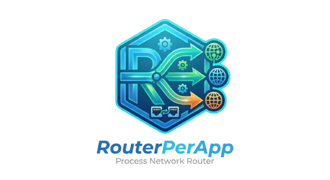
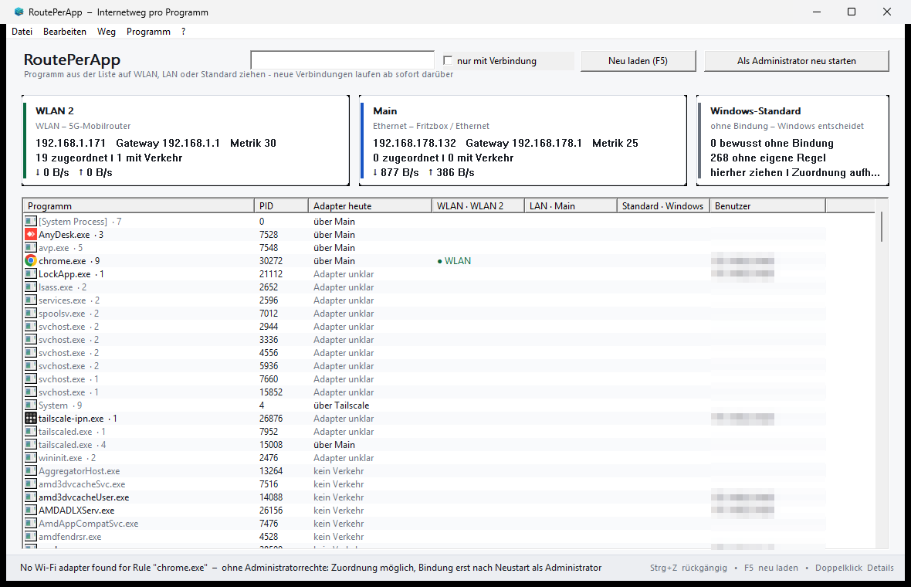
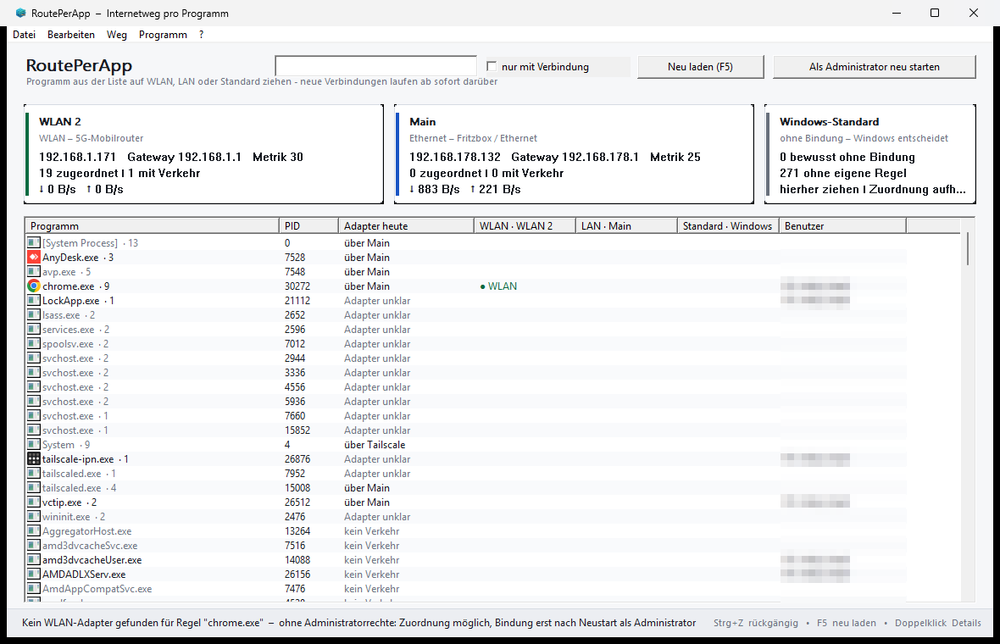

# RoutePerApp

<p align="center">
  
</p>

<p align="center">
  <strong>Route each program over its own network adapter on Windows.</strong><br>
  One program over Wi-Fi, another over Ethernet, both connections at the same time -
  no VPN, no TUN adapter, no proxy, no kernel driver.
</p>

<p align="center">
  <a href="#build"></a>
  <a href="#build"></a>
  <a href="CHANGELOG.md"></a>
  <a href="LICENSE"></a>
</p>

---

Windows prefers one adapter and keeps using it for everything while the link is up. Connected over
Wi-Fi and Ethernet at the same time, that means the browser, the updater, the backup job and the
game all share whichever adapter the routing table happens to prefer - and raising the interface
metric moves every one of them together. Some programs let you pick an adapter, most do not.

RoutePerApp decides per program. Drag a program from the process list onto the Wi-Fi card, the
Ethernet card, or the "standard" card, and the assignment stays in force while RoutePerApp runs:
for the program that is already running, and for every later start of that program. The list shows
the adapter and the traffic over it, so an assignment can be measured instead of trusted.

The interface is available in German and English, switched from a menu.

<p align="center">
  
  <br>
  <em>The window: programs on the left, the three cards on the right. The columns show the adapter
  a program actually uses today and the traffic over it.</em>
</p>

## Contents

- [What it does](#what-it-does)
- [Get it](#get-it)
- [Using it](#using-it)
- [How it works](#how-it-works)
- [Common questions](#common-questions)
- [How it compares](#how-it-compares)
- [Known limits](#known-limits)
- [Build](#build)
- [Testing](#testing)
- [Language](#language)
- [Command line](#command-line)
- [Changes](#changes)
- [License](#license)

## What it does

- **Routing per program** - Wi-Fi, Ethernet, or the normal Windows route, chosen per executable.
- **Assignments outlive the program** - rules are stored, matched again on every scan, and applied
  to programs that start later.
- **One default route for everything else** - programs without their own rule follow a default you
  pick (Windows standard, Wi-Fi, or Ethernet).
- **32-bit and 64-bit targets** - both helper DLLs are built and chosen by target bitness.
- **Runs in the background** - closing the window hides it to the notification area; routing keeps
  working. Exit explicitly from the tray menu or File -> Exit.
- **Autostart as a scheduled task** - a task in Task Scheduler, because Run-key entries do not
  start programs that ask for administrator rights.
- **Global shortcuts** - Ctrl+Alt+W / Ctrl+Alt+L / Ctrl+Alt+S route the window that is in front,
  Ctrl+Alt+H brings RoutePerApp back.
- **Visible traffic** - bytes per adapter and per program, adapter today, gateway and metric per
  card, so the chosen route can be checked while it is used.
- **Undo** - the last assignment can be taken back without searching for the program again.
- **German and English interface** - switched from the ? menu and remembered; the wording lives in
  JSON files, so a translation can be corrected without building again.
- **No VPN, no TUN adapter, no proxy, no kernel driver.**

## Get it

1. Take `routeperapp.exe`, `hook.dll` and `hook32.dll` from the
   [latest release](releases) and put all three in one folder.
2. Start `routeperapp.exe` and accept the administrator prompt - without administrator rights,
   programs of other users and services cannot be reached.

Or build it yourself in one command (see [Build](#build)); the source, the tests and the build
script are all here, and nothing is downloaded while building. If you build, keep all three files
in one folder - the program takes its helpers from its own folder and copies them into a protected
subfolder of its own.

The files are not signed, and the program injects helper DLLs into other processes. Anti-virus
products can react to exactly that pattern, which is why [Security](SECURITY.md) states plainly
what the program does and why.

## Using it

1. Start `routeperapp.exe`. The list shows the programs that are running with a network connection.
2. Drag a program onto a card, or use the context menu of the list. The card can also be reached by
   column, and the last assignment can be taken back with Ctrl+Z.
3. Close the window when you are done: RoutePerApp hides to the notification area and keeps
   routing, so programs started later are handled as well.
4. Exit with the tray icon menu (right click) or File -> Exit.

Global shortcuts, working while the window is hidden:

| Shortcut | Effect |
|---|---|
| Ctrl+Alt+W | route the window in front over Wi-Fi |
| Ctrl+Alt+L | route the window in front over Ethernet |
| Ctrl+Alt+S | route the window in front over the normal Windows route |
| Ctrl+Alt+H | bring the RoutePerApp window back |

A shortcut also brings RoutePerApp to the front: shortcuts are attached to a window, and a window
that stays hidden cannot act on them.

## How it works

Each assignment is a rule: process image name, optional path, route mode, adapter GUID. The engine
resolves rules against the adapters that are present, injects the matching helper DLL into the
target process, and the helper intercepts the Winsock calls that choose a source address (`bind`,
`connect`, `sendto`, `WSAConnect`, `WSASendTo`) and rebinds sockets to the chosen adapter. Nothing
is patched in system files and no filter driver is installed.

State is shared through plain files in `C:\ProgramData\RoutePerApp`, so the engine, the injected
helper and the interface never need a privileged channel:

```
C:\ProgramData\RoutePerApp\
  rules.json        assignments, edited by the interface, reloaded on content change
  rules.json.bak    previous copy, used if the live file is damaged
  resolved.json     what the engine decided, read by the helper DLL
  hooks\hook.dll    helper for 64-bit targets, copied from the program folder and checked by hash
  hooks\hook32.dll  helper for 32-bit targets
  settings.json     window state, language, autostart and shortcut switches
  language.en.json  optional translation override, see Language
  selbsttest.log    result of the built-in self-test
```

The `hooks` folder is the only place a helper is ever read from. RoutePerApp copies both helpers
there from its own folder, compares both by SHA-256, and refuses to inject when a file is missing
or differs. Ordinary accounts cannot write that folder; [Security](SECURITY.md) has the details.

## Common questions

**How do I force a program to use Wi-Fi instead of Ethernet on Windows?**
Assign that program to the Wi-Fi card in RoutePerApp. Only that program's new connections go over
Wi-Fi; everything else keeps the route Windows chose.

**Can I use Wi-Fi and Ethernet at the same time?**
Yes - that is the situation this is built for. Both links stay as they are, no adapter is disabled
and no metric is changed; the choice happens per program.

**Is this a VPN, a proxy or a split tunnel?**
None of them. There is no adapter added, no traffic redirected through a middleman and no
encryption layer. Connections simply get a different source address, chosen per program.

**Is there a ForceBindIP alternative with a graphical interface?**
That is what this is. ForceBindIP binds a program to an IP address from a command line and is
closed source; RoutePerApp keeps the same mechanism for 32-bit and 64-bit targets, adds a process
list, cards, rules that survive a restart, and its source is available under GPL-3.0.

**Can two windows of the same browser use different adapters?**
Not while they run in the same process: binding happens per process, and Chromium and Firefox share
one network stack for all their windows. The way to get two independent routes is two processes,
each with its own profile directory:

```
chrome.exe --user-data-dir=C:\ChromeProfile2
firefox.exe -P banking -no-remote
```

Each then has its own network stack and can be assigned its own card. (`--profile-directory` alone
does not do it: that keeps the same browser process and the same sockets.)

**Why does DNS still go over the other adapter?**
Name resolution is done by the Windows DNS Client service, not by the program, so those lookups use
the default route. Applications that resolve through their own stack do follow the assignment.

**Do I need a driver, and is the program signed?**
No driver. The files are unsigned, which is honest but annoying: some products treat an unsigned
binary that injects DLLs as suspicious by default. Building from source takes one command.

**Does it work for games or programs with anti-cheat?**
Sometimes not, and sometimes at a price. Anti-cheat and anti-injection software can refuse the
helper DLL, and an injected DLL can be mistaken for a cheat. Use it on such programs at your own
risk, and read [Known limits](#known-limits).

**Can I control it from a script?**
Not yet through a command line tool, but the rules live in `rules.json`, which the engine reloads
when the content changes, so editing that file is already the scripted path. A `srctl` command tool
is planned.

**Which Windows versions?**
Windows 10 and 11, x64, with 32-bit target support through the second helper.

## How it compares

| | RoutePerApp | ForceBindIP | Interface metric | VPN split tunnel |
|---|---|---|---|---|
| Decide per program | yes | yes, from a command line | no, system-wide | depends on the VPN client |
| Interface | process list, cards, drag and drop | command line | two numeric fields | client dependent |
| Both adapters stay usable | yes | yes | usually one wins | traffic goes through the tunnel |
| Extra adapter or driver | none | none | none | TUN adapter, often a driver |
| 32-bit and 64-bit targets | both helpers built | depends on the launcher | - | - |
| Visible traffic per program | yes | no | no | client dependent |
| Source and license | public, GPL-3.0 | closed freeware | part of Windows | vendor dependent |

Related approaches worth knowing: `ForceBindIP` solves the same problem from a command line, and
TUN-based routers such as `sing-box` or `NICRoute` move traffic through a virtual adapter with a
rule engine - more control over destinations, more machinery in the network path. RoutePerApp stays
on the "pick the source address per program" level and adds the interface around it.

## Known limits

Read these before reporting a problem.

- **DNS lookups are not routed.** Name resolution is done by the Windows DNS Client service, not
  by the program, so those requests use the default route. Applications that resolve through their
  own stack do follow the assignment.
- **Chromium browsers are not verified.** Chromium moved networking into a separate process and
  blocks injected DLLs in parts of itself. The rule can match, the effect can be missing. If you
  test this, please report what you measured.
- **Connections opened before the helper is in place keep their old route.** Re-bind a program with
  Program -> Rebind running programs after changing an assignment.
- **Multiple windows of one process share one route.** Binding is per process - see the browser
  question above.
- **Dragging files from Explorer onto a card does not work while elevated.** Windows does not allow
  a lower-integrity process (Explorer) to drag onto a higher-integrity one. Dragging inside
  RoutePerApp is unaffected.
- **Programs with anti-cheat or anti-injection may refuse the helper**, and an injected DLL can be
  mistaken for a cheat. Use it on such programs at your own risk.
- **Anti-virus products may flag the files.** Process injection is what this program does, and the
  behaviour is the same one malware uses. Build from source if you want a binary you trust, and see
  [Security](SECURITY.md).
- **Programs that do not use Winsock** (rare) are not affected.

## Build

Needs Windows 10 or 11 and Visual Studio Build Tools 2019 or 2022 with the "Desktop development
with C++" workload. No third-party libraries, no package manager, no project file.

```
build.cmd             everything (tests + program)
build.cmd exe         program and both helper DLLs
build.cmd tests       tests only
build.cmd probe       additionally a build without the elevation request, used by automated tests
```

`build.cmd` finds `vcvars64.bat` for VS 2019/2022 (BuildTools, Community, Professional,
Enterprise) and derives the 32-bit environment for the 32-bit helper. The C runtime is statically
linked, so the resulting files need no redistributable. The version number is in
`src\resource.hpp`.

| Output | What it is |
|---|---|
| `build\routeperapp.exe` | the program (64-bit, requests administrator rights, manifest in `app.manifest`) |
| `build\hook.dll` | helper for 64-bit targets |
| `build\hook32.dll` | helper for 32-bit targets |
| `build\tests.exe`, `gui_tests.exe`, `inject_tests.exe`, `srtarget.exe` | test programs |

## Testing

```
build\tests.exe          core: rules, adapter choice, file handling, language layer
build\gui_tests.exe      interface logic: zones, undo, drag decisions
build\inject_tests.exe   real injection into srtarget.exe, measured per adapter
```

Current counts: 364 core checks, 129 interface checks, 89 integration checks, no failures.

The flow that is otherwise only observable from outside is built into the program:

```
routeperapp.exe --selbsttest
```

It checks the window, the menus, the shortcuts, hide-to-tray, the tray message, restore, and the
tray menu. It also switches the whole interface to English and fails if any visible label, menu,
column heading or caption is left untranslated. The exit code is the number of failed points,
details go to `selbsttest.log` in the data folder. That is deliberately inside the program: an
external script that posts messages into another program's window is exactly what anti-virus
heuristics report as malicious.

## Language

The interface is German first, English second. Switch it with ? -> Sprache -> English, or start
with `--sprache en`. The choice is stored in `settings.json`.

<p align="center">
  
  <br>
  <em>The same window in German.</em>
</p>

The German wording in the source is the key, the translation is the value:

```json
{
  "Datei": "File",
  "markierte Programme  \u2192  WLAN": "selected programs  \u2192  Wi-Fi"
}
```

That has two consequences worth knowing:

- `lang\en.json` is compiled into the program, and a file called `language.en.json` next to the
  executable or in `C:\ProgramData\RoutePerApp` overrides it. Correcting a wording therefore needs
  no rebuild: edit the file and restart. Adding a whole new language is described in
  [Contributing](CONTRIBUTING.md).
- A key that has no translation falls back to the German text and is counted. The self-test fails
  while a visible label is still untranslated, and writes every text the program uses into
  `language.vorlage.json` in the data folder so the missing values can be filled in elsewhere.

`tools\build_en.py` regenerates `lang\en.json` from that template, keeping the keys identical to
the source text.

## Command line

Only two switches exist today: `--selbsttest` and `--sprache de|en`. Scripted control (`list`,
`add`, `remove`, `default`, `launch --via`) is designed but not implemented; until then, rules are
edited in the interface, and `rules.json` is the file the engine reloads on change.

## Changes

[CHANGELOG.md](CHANGELOG.md) - version 1.2 guards the injected helper files with hash checks and a
closed folder; version 1.1 added the English interface, the language files, and adapter
classification that no longer depends on the interface language.

## License

GPL-3.0, see [LICENSE](LICENSE). The source, the tests and the build script are all in this
repository; nothing here is downloaded at build time. Reporting a problem or a suspicion:
[Security](SECURITY.md). Building and testing before sending a change:
[Contributing](CONTRIBUTING.md).
